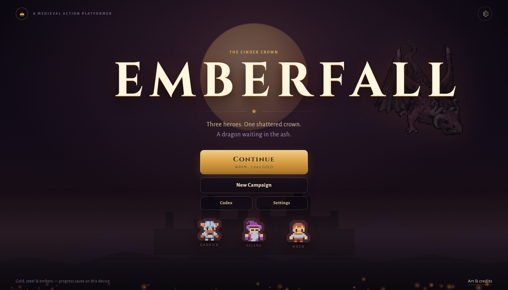
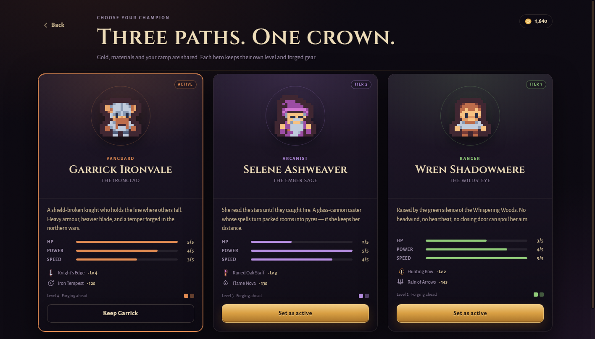
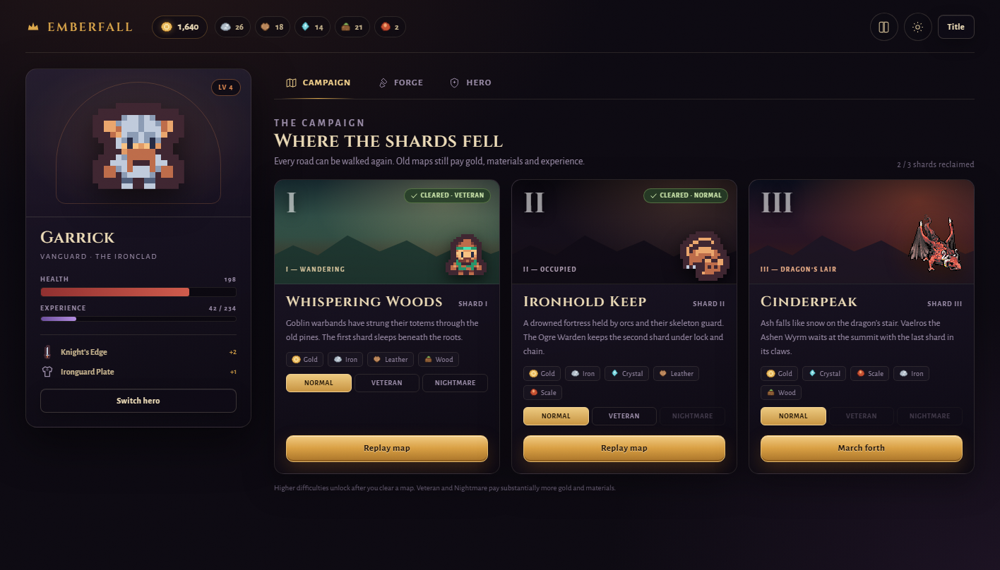
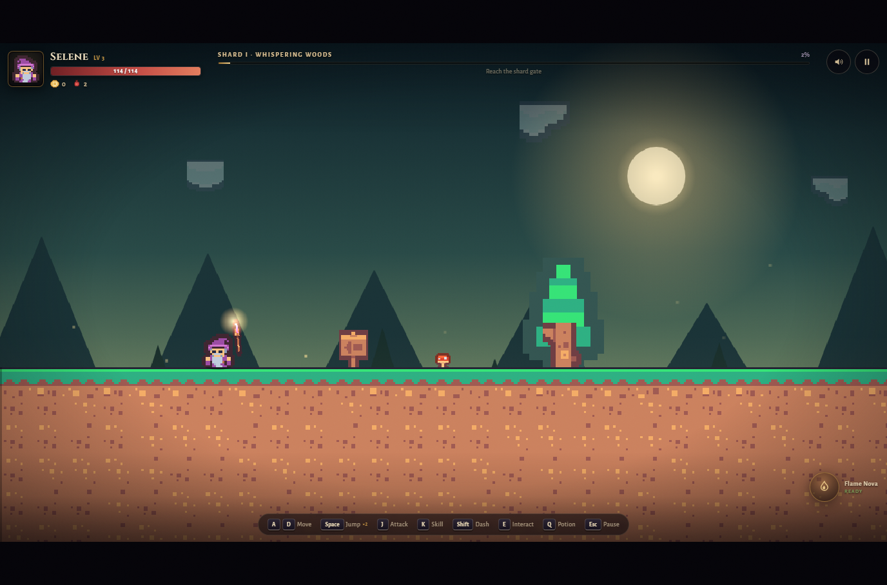
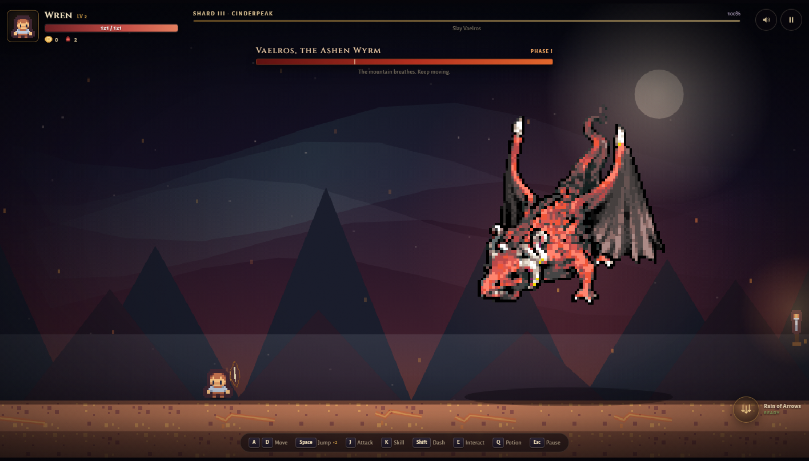
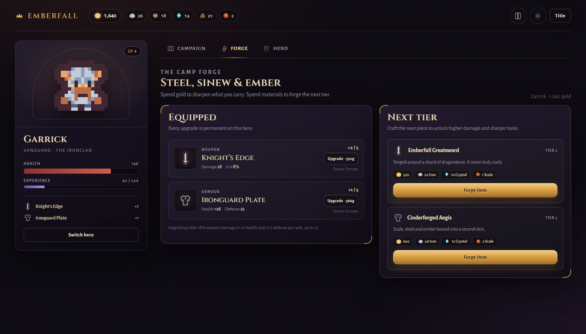
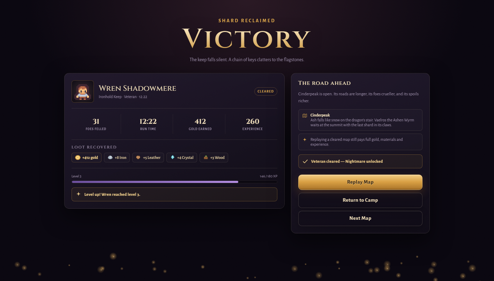
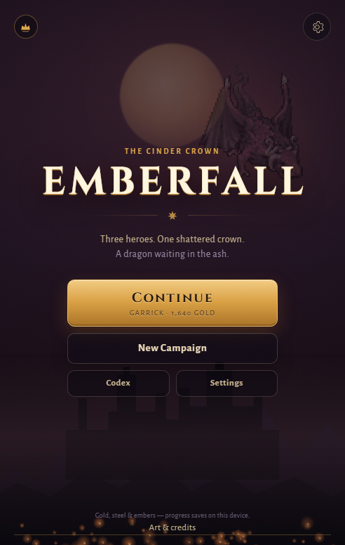
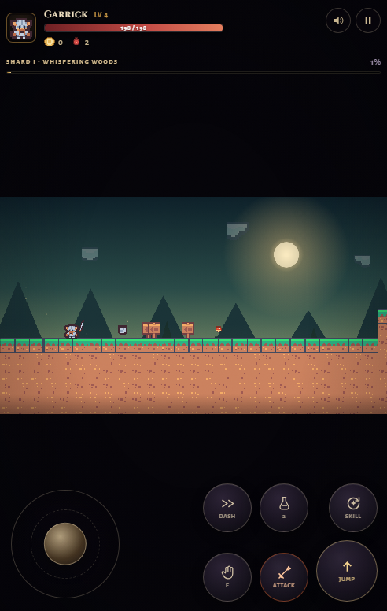
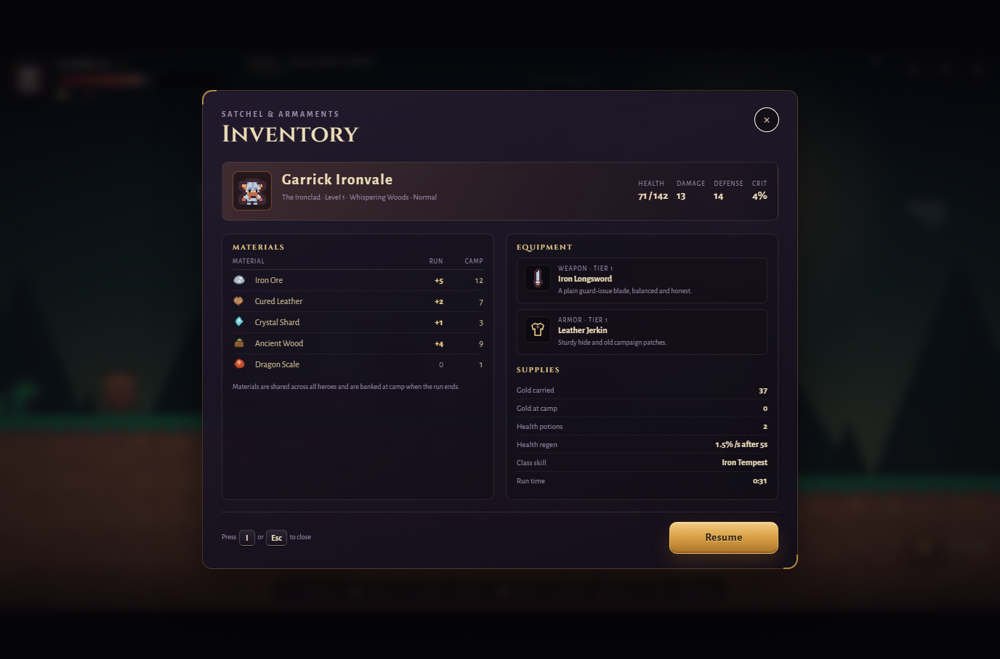

# Emberfall — The Cinder Crown

A complete medieval action-platformer that runs in any modern browser on PC and mobile.
Choose the **Warrior**, **Mage** or **Archer**, fight goblins, orcs, ogres and a fully animated
dragon, loot chests, and forge better gear at the camp.

No frameworks. No build step. No network requests at runtime. Progress saves automatically
to `localStorage`.

## Play online

**Play right now:** https://spetheof.github.io/emberfall/

No install and no local server needed on GitHub Pages. Open the link on any PC or phone.
Saves are stored per browser/domain, so the GitHub Pages copy starts its own campaign.

**Download the game:** use **Code → Download ZIP** on the repository page, or grab the packaged
build from the [latest release](https://github.com/SpeTheof/emberfall/releases/latest).



---

## Screens

| | |
|---|---|
|  |  |
| Choose a hero. Each keeps their own level and gear. | The camp: campaigns, forge and hero journal. |
|  |  |
| Fireballs, soft auto-aim, chests and readable hotkeys. | Vaelros, the Ashen Wyrm — three phases, one crown. |
|  |  |
| Craft and upgrade tiered weapons and armour. | Loot, XP, level-ups and the next shard. |
|  |  |
| Responsive title on a phone. | Portrait fallback: controls live in the letterbox. |

More screenshots (inventory, Codex, pause, settings, keep, peak) are in [`screenshots/`](screenshots/).

---

## Quick start

### Windows (recommended)

Double-click **`start.cmd`**.

It starts a tiny local web server on port `8123` and opens the game in your browser.
Browsers block ES modules loaded from `file://`, so the game must be served over HTTP.

### Any system with Python 3

```bash
cd emberfall
python -m http.server 8123 --bind 127.0.0.1
```

Then open <http://127.0.0.1:8123/>.

> Use `start-lan.cmd` (or `python -m http.server 8123 --bind 0.0.0.0`) to play from a phone
> on the same Wi-Fi. Allow Python through Windows Firewall if prompted.

### Deploying

The whole folder is a static site. Upload it to GitHub Pages, Netlify, itch.io (as an HTML
game), or any static host. No server-side code is required.

---

## What is in the game

### Three heroes, three play styles

| Hero | Role | Weapon | Class skill |
|---|---|---|---|
| **Garrick Ironvale** | Vanguard | Sword, high health and melee combos | **Iron Tempest** — spinning three-hit whirlwind |
| **Selene Ashweaver** | Arcanist | Staff fireballs with splash damage | **Flame Nova** — radial fire detonation |
| **Wren Shadowmere** | Ranger | Fast arrows with soft auto-aim | **Rain of Arrows** — ten falling arrows |

Every hero has their own level, XP, weapon tier, armour tier and upgrade ranks. Gold and
materials are shared across the camp, so switching heroes never wastes a run.

All three heroes regenerate **1.5% of maximum health per second after 5 seconds without
taking damage**. Garrick is the exception: he regenerates **even while fighting**. A green
**REGEN** badge appears in the HUD while it is active.

Garrick now deals **4× his original weapon damage** (another 2× over the previous pass), has
**double health and defence**, a wider sword sweep (**40px reach**), and **Iron Tempest**
recharges in **4 seconds**.

### Loot, crafting and upgrades

* Enemies drop **iron**, **cured leather**, **crystal shards**, **ancient wood** and — from
  the Ogre Warden and Vaelros — **dragon scales**.
* Vaelros now leaves a visible pickup hoard: piles of gold, three dragon scales, crystal and
  iron. Loot is magnetised after a short delay so you can see it land.
* Chests contain gold and rare materials, with a chance of dragon scales on later maps.
* Press **I** (or the backpack button) during a run to open the satchel: materials carried
  this run, camp stores, equipped weapon and armour, stats, potions and gold.
* Materials are shared across all heroes and are banked at camp when the run ends — whether
  you win, fall or abandon the run.
* At the **Forge** you can:
  * Upgrade any equipped weapon or armour from `+0` to `+5` with gold.
  * Craft Tier II and Tier III gear from materials and gold.
  * Every tier has different stats, names and art.
  * Recipes are per class: Knight's Edge, Pyreheart Staff, Dragonbone Bow, Cinderforged Aegis
    and more.



### Three replayable maps

| Shard | Map | Theme | Boss |
|---|---|---|---|
| I | Whispering Woods | Moonlit forest | Goblin warbands |
| II | Ironhold Keep | Torchlit castle | Ogre Warden (mini-boss) |
| III | Cinderpeak | Volcanic ash peak | **Vaelros, the Ashen Wyrm** |

All maps can be replayed for full gold, materials and XP. Clearing a map unlocks the next
one and its higher difficulties:

* **Normal** — the intended first run.
* **Veteran** — tougher enemies, +65% gold, +25% XP.
* **Nightmare** — brutal enemies, +150% gold, +55% XP, rarest spoils.

### Enemies and bosses

* **Goblin Raider** — quick, packs, lunges.
* **Orc Brute** — armoured, heavy overhead blows.
* **Cinder Bat** — flying, erratic swoops.
* **Hollow Guard** — ranged bone thrower.
* **Mire Slime** — hopping contact damage.
* **Ogre Warden** — telegraphed slam, shockwave, dragon-scale drop.
* **Vaelros, the Ashen Wyrm** — three phases, fireball fans, meteor rain, ground slams,
  a boss health bar and a shard gate after death.

### Game feel

Coyote time, jump buffering, variable jump height, double jump, dash with i-frames,
camera shake, hit-stop, damage numbers, particle bursts, screen-space weather, parallax
backgrounds, torchlight, loot magnets, telegraphed enemy attacks, checkpoints, potions,
soft auto-aim for ranged attacks, gamepad support and a responsive HUD.

---

## Controls

### Keyboard

| Input | Action |
|---|---|
| `A` / `D` or `←` / `→` | Move |
| `Space` / `W` / `↑` | Jump (press twice for double jump) |
| `J` or left click | Attack |
| `K` | Class skill |
| `Shift` | Dash |
| `E` | Interact / open chest / kindle checkpoint / enter gate |
| `Q` | Drink a health potion |
| `I` | Open satchel / inventory |
| `Esc` | Pause |
| `M` | Mute / unmute |

The full list is also shown in-game on the bottom hotkey bar and in the pause menu.

### Gamepad

Left stick / D-pad to move, **A** jump, **X** attack, **Y** skill, **B** dash, **LB** potion,
**Start** pause.

### Touch

Touch controls appear automatically on phones and tablets, or can be forced from
**Settings → Touch controls**.

* Left joystick to move.
* **Jump** and **Attack** on the right.
* **Skill**, **Dash**, **Potion** and **Interact** around them.
* The backpack button in the top-right opens the in-run inventory.
* Portrait is supported with the HUD/controls moved into the letterbox; landscape is
  recommended and triggers a one-time rotate hint.
* Multi-touch is supported (move + jump + attack at the same time).

---

## Project structure

```
emberfall/
  index.html                 screens, HUD, modal markup
  styles.css                 dark-fantasy responsive UI
  start.cmd                  one-click local server + browser
  start-lan.cmd              LAN server for phone testing
  js/
    main.js                  boot, asset loading, debug hooks
    game.js                  physics, combat, enemies, boss, rendering
    world.js                 procedural level generation, terrain, backgrounds
    ui.js                    menus, camp, forge, HUD, results, touch controls
    data.js                  heroes, gear, enemies, maps, recipes, lore
    save.js                  localStorage save + economy + progression
    assets.js                image loading, tile cropping, pixel icons
    audio.js                 procedural WebAudio music and SFX
    input.js                 keyboard, gamepad, pointer and virtual input
    icons.js                 inline SVG icon set
  assets/
    tiny-dungeon/            Kenney CC0 characters, monsters, props + atlas
    pixel-platformer/        Kenney CC0 terrain, props, chests + atlas
    dragon/                  CC0 dragon boss sprite + license note
    fonts/                   local Cinzel + Alegreya Sans + OFL licenses
  screenshots/               curated screens from the finished build
  tools/                     CDP/QA helper scripts (not needed to play)
  CREDITS.md                 full attribution and licenses
```

Progression data lives in `localStorage` under `emberfall.save.v1`. There is no account,
analytics, remote call, or telemetry.

---

## Design notes

* **Rendering** — the game world is authored in 16px tiles and rendered with a fixed
  internal 1280×720 canvas at 3× zoom. The HTML UI scales independently so text and
  buttons stay crisp on phones, tablets and desktops.
* **Level generation** — each map is assembled from hand-tuned templates (flats, gaps,
  staircases, raised treasure plinths, bridges, ambush arenas, checkpoints, mini-boss room)
  with a seeded RNG. Every run has a different layout, but the difficulty curve and
  reachable geometry remain consistent.
* **Assets** — Pixel Platformer’s source tiles are 18×18 with a 1px border; the atlas
  pipeline crops them to 16×16 core tiles so terrain meets seamlessly. Tiny Dungeon
  characters and props are 16×16. Both are loaded as two small atlases, sliced into
  canvases at boot, so the game makes only a handful of network requests.
* **Audio** — all music and SFX are synthesized with the Web Audio API at runtime: a
  plucked lute/pad/drum loop with different moods for title, camp, battle, boss and
  results, plus synthesized hits, jumps, spells and louder menu clicks/hover tones.
  The mix runs through a limiter with dedicated slash, bow-release and fireball layers.
* **Save safety** — saves are sanitized on load; malformed data falls back to defaults.

---

## Known limitations

* Saves are local to the browser and device. Clearing site data erases progress.
* Portrait mobile play works but is intended as a fallback; landscape is much better.
* Audio begins after the first tap/click, per browser autoplay rules.
* The game is a complete, self-contained v1; additional biomes, classes or online
  leaderboards would be separate content additions.

---

## Credits

All art is free/public-domain or openly licensed:

* **Kenney** — Tiny Dungeon (CC0) and Pixel Platformer (CC0). <https://kenney.nl>
* **Blarumyrran** — “Dragons” (CC0), via OpenGameArt. <https://opengameart.org/content/dragons>
* **Cinzel** and **Alegreya Sans** — SIL Open Font License 1.1.

Full license texts and links are in [`CREDITS.md`](CREDITS.md) and the `assets/` folders.

Built with vanilla HTML5 Canvas, CSS and ES modules. No third-party runtime dependencies.
